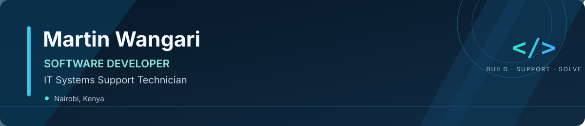

  

<h1 align="center">Hi, I'm Martin Wangari</h1>

  <strong>Software Developer · IT Systems Support Technician</strong> 
  Nairobi, Kenya · Building practical digital solutions and keeping technology running reliably.

  <a href="https://marttin-wangari.vercel.app/">Portfolio</a> ·
  <a href="https://linkedin.com/in/martin-wangari-586903230">LinkedIn</a> ·
  <a href="mailto:martindevs07@gmail.com">Email</a> ·
  <a href="https://github.com/SolezMartins">GitHub</a>

---

## About Me

I'm a technology professional based in Nairobi, Kenya, combining hands-on IT support experience with practical software development. I build web applications and business solutions, troubleshoot hardware and software issues, support users, and work with networking and server technologies.

- **Software development:** Web applications, business tools, and full-stack projects.
- **IT support:** Hardware and software troubleshooting, printer support, and end-user training.
- **Infrastructure:** Wi-Fi technologies, networking, and server support.
- **Currently open to:** Remote IT Support, Technical Support, Software Development, and related opportunities.

## Featured Projects

> Add your own project screenshots to the `assets/` folder and replace the sample image paths and project links below before publishing.

<table>
  <tr>
    <td width="50%" valign="top">
      <h3>Mpambe Hotel POS</h3>
      
A point-of-sale project for hospitality operations. Highlight the features you have implemented, such as sales, inventory, or reporting.

      
<strong>Stack:</strong> Add the technologies used in this project.

      
<a href="https://github.com/SolezMartins">View repositories →</a>

    </td>
    <td width="50%" valign="top">
      <h3>Maxland Properties PMS</h3>
      
A property management project focused on organizing property information and management workflows.

      
<strong>Stack:</strong> Add the technologies used in this project.

      
<a href="https://github.com/SolezMartins">View repositories →</a>

    </td>
  </tr>
  <tr>
    <td width="50%" valign="top">
      <h3>GO-BODA</h3>
      
A ride-hailing project focused on booking and dispatch workflows.

      
<strong>Stack:</strong> React · Supabase (where applicable)

      
<a href="https://github.com/SolezMartins">View repositories →</a>

    </td>
    <td width="50%" valign="top">
      <h3>Interactive Developer Portfolio</h3>
      
A portfolio showcasing selected projects, technical skills, and development work.

      
<a href="https://marttin-wangari.vercel.app/">Visit portfolio →</a>

    </td>
  </tr>
</table>

## Technical Skills

### Development

### Databases, APIs & Tools

### IT Support & Infrastructure

- Hardware and software troubleshooting
- Printer support and end-user training
- Wi-Fi and networking support
- Server support
- Microsoft 365 and productivity tools
- AI tools and automation

## Let's Connect

I'm happy to connect with recruiters, developers, IT professionals, and teams looking for someone who can contribute across technical support and software development.

- **Portfolio:** https://marttin-wangari.vercel.app/
- **LinkedIn:** https://linkedin.com/in/martin-wangari-586903230
- **Email:** martindevs07@gmail.com
- **GitHub:** https://github.com/SolezMartins

<em>Building solutions. Solving problems. Growing through technology.</em>

