<div align="center">



<br/>

[](https://marttin-wangari.vercel.app/)
[](https://marttin-wangari.vercel.app/Martin_Wangari_Resume.pdf)
[](https://wa.me/254740208683)


</div>

---

## 👋 About me

Software developer and IT systems support specialist with **3+ years** of experience across IT support, network infrastructure, hardware diagnostics and full-stack web development. I build POS, property and school management systems and a ride-hailing app, and I bring hands-on hardware skills too: PCB repair, smart-meter firmware and fiber optic splicing.

```ts
const martin = {
  name: "Martin Mwangi Wangari",
  base: "Nairobi, Kenya 🇰🇪",
  roles: ["Software Developer", "IT Systems Support"],
  openTo: ["Full-time", "Contract / Freelance", "Remote or on-site in Nairobi"],
  status: "Available now",
};
```

---

## 🛠️ Tech stack

**Software development**


**IT support & administration**


**Networking & infrastructure**


**API & data**


---

## 🚀 Projects

### Live client work

| Project | Description |
|---|---|
| 🏥 **[Eduwincare](https://eduwincare.com)** | Accessibility-focused healthcare website for a Minnesota-based homecare service |
| 🚚 **[Sammy Trucks](https://sammytrucks.netlify.app)** | Sales site for an ISUZU truck dealer in Ruaka: inventory, financing guidance, payment calculator, WhatsApp lead capture |
| 🧬 **[MicroAfia Healthcare](https://marttin-wangari.vercel.app/build/microafia-healthcare/)** | DNA paternity testing site with pricing, process info, FAQ and booking form (React + Vite) |

### Demos & builds

| Project | Description |
|---|---|
| 🍽️ **[Mpambe Hotel POS](https://marttin-wangari.vercel.app/build/mpambe-hotel/)** | Touch-friendly restaurant POS: dine-in, takeaway, delivery, multiple payment methods, receipts, inventory, reports |
| 🏢 **[Maxland Properties PMS](https://marttin-wangari.vercel.app/build/maxland-properties/)** | Property management: leases, rent invoicing, M-Pesa payment simulation, arrears, maintenance tickets |
| 🧴 **[ByZenna Essence](https://marttin-wangari.vercel.app/build/byzenna-essence/)** | Luxury fragrance storefront with cart, wishlist and simulated checkout |
| 🎓 **[Benuru Group of Schools SMS](https://marttin-wangari.vercel.app/build/benuru-school/)** | School management for Kenyan schools: records, fees, attendance, exams, parent portal |
| 🏫 **[Joyrinah Schools Management System](https://marttin-wangari.vercel.app/build/joyrinah-schools/)** | Role-based platform: admissions, fees, LMS, HR and analytics |

### 🔧 In progress

- 🚗 **Ride-Hailing Platform**: real-time booking, dispatch and driver tracking (React · Supabase · PostgreSQL REST APIs)
- 🏷️ **IT Asset Tag Manager**: Chrome/Edge extension for tagging equipment and looking up asset records, with offline support via IndexedDB

---

## 💼 Experience

| Period | Role | Highlights |
|---|---|---|
| **Mar 2025 – Present** | IT Systems Support Technician<br/>*Independent Contractor, Nairobi* | 1st/2nd-line support, Office 365 admin, API testing with Postman, IT asset inventory, user training materials |
| **Jul 2022 – Feb 2025** | Repair / PCB Technician<br/>*M-Gas Kenya Ltd* | PCB diagnosis and repair, component replacement, smart-meter firmware installation and testing |
| **Jan 2022 – Jun 2022** | Field Network Technician<br/>*G-Tech Technology Ltd* | Residential fiber installs across Nairobi, splicing and repairs, router configuration |
| **Mar 2021 – May 2021** | Industrial Attachment<br/>*Broadband Communication Networks Ltd* | Cabling, router and telephone system installs, fiber diagnostics, server network hardware config |

---

## 🎓 Certifications

- 🎓 Diploma in ICT
- 🏅 Information Technology Fundamentals: IBM Skills Build
- 🏅 Data Analytics: IBM Skills Build
- 🏅 Data Analytics: ICT Authority of Kenya
- 🏅 Web Design: Inceptor Institute of Technology
- 🏅 Power BI and AI: Exodus Experts

---

## 📊 GitHub stats

<div align="center">


</div>

---

## 📫 Let's connect

<div align="center">

[](mailto:martindevs07@gmail.com)
[](https://linkedin.com/in/martin-wangari-586903230)
[](https://wa.me/254740208683)
[](https://marttin-wangari.vercel.app/)

<sub>WhatsApp is the fastest way to reach me. Rates shared on request.</sub>

</div>
